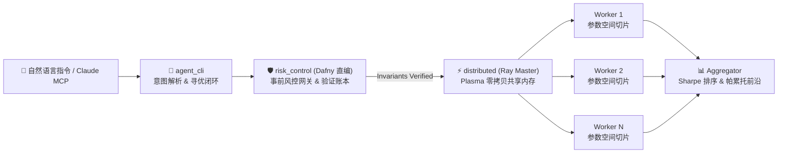

# 🛡️ VeriQuant — Verified Distributed Quant & Agent Engine

[-brightgreen)](docs/formal_verification_spec.md)
[](pyproject.toml)
[](distributed/README.md)

**VeriQuant** 是一个将 **形式化验证（Dafny）**、**零拷贝分布式回测（Ray）** 与 **神经符号 CLI Agent（Typer / MCP）** 深度结合的量化回测与风控决策引擎。

---

## 🏗️ 系统架构 (Neuro-Symbolic Architecture)



---

## 🔗 验证对接（Dafny → Python 运行时）

证明过的代码**就是运行时执行的那份**，不是「另外重写一份」。事件驱动回测 `core_engine.backtester.run_verified_backtest` 的每一笔资金变动都走 Dafny 编译出来的原语（冻结 `TryLockOrderCash` → 成交 `FillOrder` → 卖出 `SellPosition` → 费用 `PayCost`），由 `risk_control.gateway.VerifiedLedger` 桥接；`portfolio.py` 负责调仓、`matching_engine.py` 负责滑点/手续费/涨跌停。验证网关在运行时**真的会拦单**（见 `tests/test_verified_integration.py` 的 `rejections` 断言）。

```python
from core_engine.backtester import run_verified_backtest
from core_engine.config import load_risk_config

result = run_verified_backtest(
    prices,
    {"strategy": "ma_crossover", "fast": 5, "slow": 20},
    load_risk_config(),
)
result["rejections"]   # 被 Dafny 验证网关 / 涨跌停拦截的订单数
```

---

## ✨ 核心 ：

### 1. Dafny 形式化验证风控内核（0 运行时违约）
在 `dafny_verification/src/` 中基于**定点数算术（`SCALE = 10,000`）**严格证明了 45 个验证条件（VC），规避 IEEE-754 浮点数精度漂移（详见 [`dafny_verification/README.md`](dafny_verification/README.md) 与 [`docs/formal_verification_spec.md`](docs/formal_verification_spec.md)）：

| 模块文件                | 核心数学定理与不变量                                                                          | 验证条件 (VCs) |    状态    |
| :---------------------- | :-------------------------------------------------------------------------------------------- | :------------: | :--------: |
| `AccountInvariants.dfy` | **资金守恒定理**（`TotalCash` / `NetEquity` 守恒）、**无透支不变式**、**2.0x 杠杆上限不变式** |       2        | ✅ Verified |
| `OrderStateMachine.dfy` | **单向生命周期推进**、**部分成交净值守恒**、**撤单精确解冻与终态防双花（Anti-Double-Spend）** |       3        | ✅ Verified |
| `StopLossBounds.dfy`    | **有界滑点止损定理**：在显式前置条件 `\|ΔPrice\| ≤ MaxGap` 下，严格界定多头最大止损边界       |       2        | ✅ Verified |
| `RiskGateway.dfy`       | **原子事前风控网关（`PreTradeGateway`）** + 完整订单生命周期端到端守恒 + `{:test}` 断言       |       38       | ✅ Verified |

* 💡 **调优->Z3 NIA 规避策略**：将账户级可变杠杆重构为系统级编译期常量 `MAX_LEVERAGE_BPS`，使杠杆约束退化为**纯线性整数算术（LIA）**；同时将含真非线性乘积的 `StopLossBounds.dfy` 与运行时网关隔离验证，彻底消除 Z3 非线性启发式搜索超时问题。

### 2. Ray 零拷贝分布式回测与比特级确定性
* **拒绝按时间切片（Anti-Time-Sharding）**：策略具有路径依赖状态，按时间切片会导致跨切片持仓断裂或未来函数泄漏。本引擎严格按**参数空间（Parameter Grid）**与**截面标的**扇出任务（详见 [`distributed/README.md`](distributed/README.md)）。
* **Plasma 零拷贝共享内存**：行情矩阵通过 `ray.put()` 仅写入一次本地共享内存，所有 Worker 直接读取只读内存视图（零序列化开销）。
* **单机 == 分布式比特级一致**：由 `tests/test_distributed_consistency.py` 严格断言单进程与多核分布式回测结果（含净值曲线与各项指标）100% 逐比特一致。

### 3. CLI Agent 自然语言交互与帕累托前沿筛选
* 支持自然语言驱动回测与风控校验（内置启发式离线解析 + OpenAI API 双模式），并支持通过 `FastMCP` 导出为标准 MCP Server。
* 聚合层（`distributed/aggregator.py`）除夏普比率排序外，内置 `(Sharpe, MaxDrawdown)` 二维**帕累托前沿（Pareto Frontier）**非支配筛选。

---

## 📂 仓库目录结构与配置说明

风险/撮合参数位于 `configs/default_risk.yaml`，Ray 集群参数位于 `configs/ray_cluster.yaml`，通过 `core_engine.config.load_risk_config()` / `load_ray_config()` 加载；代码中的 `DEFAULT_RISK_CONFIG` 作为兜底默认值。

```text
veriquant/
├── dafny_verification/          # Dafny 4.x 形式化规约、定理证明与编译脚本
│   ├── src/                     # Types / AccountInvariants / OrderStateMachine / StopLossBounds / RiskGateway
│   ├── build_py.sh / .ps1       # 一键验证并直编为 Python 运行时模块
│   └── README.md                # Z3 非线性算术 (NIA) 排障实录与证明细节
├── risk_control/                # 浮点 <-> 定点数桥接层 (VerifiedLedger & RiskGateway)
│   ├── _generated/              # Dafny 编译生成的 Python 目标代码 (可直接 import)
│   └── gateway.py               # 对接 Dafny 生成原语的状态化安全账本
├── core_engine/                 # 回测核心引擎（支持高速向量化 & Dafny 事件驱动双路径）
│   ├── backtester.py            # run_single_backtest & run_verified_backtest
│   ├── config.py                # YAML 风险与集群配置加载器
│   ├── portfolio.py             # VerifiedPortfolio（每笔调仓/扣费均经过 Dafny 原语校验）
│   ├── matching_engine.py       # 滑点、手续费与涨跌停板流动性锁死模型
│   └── metrics.py               # Sharpe / Sortino / MaxDrawdown / Calmar 纯函数计算
├── distributed/                 # 基于 Ray 的 Master-Worker 零拷贝调度层
├── agent_cli/                   # Typer + Rich 终端交互层 & FastMCP 服务端
├── strategies/                  # 策略插件注册表（MACrossover 等）
├── data_layer/                  # 确定性几何布朗运动 (GBM) 行情生成、Yahoo Finance 与 Parquet 缓存
├── configs/                     # 风控参数与 Ray 集群 YAML 配置
├── tests/                       # 桥接测试、分布式比特一致性断言、Hypothesis 属性测试与性能基准
└── docs/                        # 形式化验证白皮书 (formal_verification_spec.md) 与验证报告
```

---

## 🚀 快速开始与常用命令

### 1. 环境配置与安装
核心依赖为 `numpy`、`pandas`、`ray`、`pyyaml`、`typer`、`rich`（开发测试含 `pytest`、`hypothesis`，可选安装 `yfinance` 拉取真实行情）。

```bash
python -m venv .venv
# Linux / macOS:
source .venv/bin/activate
# Windows PowerShell:
# & ".venv\Scripts\Activate.ps1"

pip install -e ".[dev]"
```

<details>
<summary>💡 <b>Windows 多解释器冲突（如 MSYS2）与 Dafny 本地构建配置说明（点击展开）</b></summary>

本仓库推荐使用独立的虚拟环境 `.venv`，避免 Windows `PATH` 上多个 Python（如 MSYS2 的 `python.exe` 与系统 Python）互相污染：

```powershell
# 1) 指定系统 Python 3.10+ 解释器路径创建 venv（只需一次）
& "python.exe" -m venv .venv

# 2) 安装依赖（只需一次）
& ".venv\Scripts\python.exe" -m pip install -e ".[dev]"

# 3) 之后每次激活环境（激活后 python/pytest 一律指向 .venv 内解释器）
& ".venv\Scripts\Activate.ps1"
```

**Dafny 验证模块构建（仅修改 `.dfy` 后重新编译时需要）**：  
需要 `dafny >= 4.x` 在 `PATH` 上（本项目验证使用 Dafny 4.9.0），或设置环境变量 `$env:DAFNY` 指向 `Dafny.exe` 可执行文件：

```powershell
powershell -ExecutionPolicy Bypass -File dafny_verification/build_py.ps1   # verify + 编译 Python
```
</details>

### 2. 常用测试与基准命令（`.venv` 已激活）
```powershell
# 运行全部单元测试、Dafny 桥接测试、端到端拒单集成测试与 Hypothesis 属性测试
python -m pytest -q

# 验证分布式一致性（单机 == Ray 逐比特一致）+ 加速比基准测试
python tests/test_distributed_consistency.py
python tests/benchmark_ray.py

# 运行 CLI Agent 自然语言策略回测与 Dafny 事前风控网关测试
veriquant agent "用MA交叉策略回测过去3年数据，夏普比率目标1.2以上"
veriquant verify-gate --cash 100000 --notional 300000
```
