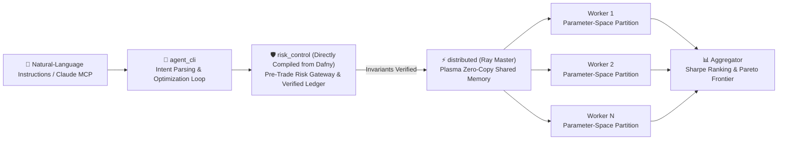

# 🛡️ VeriQuant — Verified Distributed Quant & Agent Engine
**Language:** [English](README.md) | [简体中文](README.zh-CN.md)

[-brightgreen)](docs/formal_verification_spec.md)
[](pyproject.toml)
[](distributed/README.md)

**VeriQuant** is a quantitative backtesting and risk-control decision engine that tightly integrates **formal verification (Dafny)**, **zero-copy distributed backtesting (Ray)**, and a **neuro-symbolic CLI agent (Typer / MCP)**.

---

## 🏗️ System Architecture (Neuro-Symbolic Architecture)



---

## 🔗 Verified Integration (Dafny → Python Runtime)

The **formally verified code is the code executed at runtime**, not a separately rewritten implementation. Every cash movement in the event-driven backtester, `core_engine.backtester.run_verified_backtest`, goes through primitives compiled from Dafny: reserve funds (`TryLockOrderCash`) → execute a fill (`FillOrder`) → sell a position (`SellPosition`) → pay fees (`PayCost`). The bridge is provided by `risk_control.gateway.VerifiedLedger`; `portfolio.py` handles rebalancing, while `matching_engine.py` handles slippage, transaction fees, and price-limit restrictions.

The verification gateway **actually rejects orders at runtime**, as demonstrated by the `rejections` assertions in `tests/test_verified_integration.py`.

```python
from core_engine.backtester import run_verified_backtest
from core_engine.config import load_risk_config

result = run_verified_backtest(
    prices,
    {"strategy": "ma_crossover", "fast": 5, "slow": 20},
    load_risk_config(),
)
result["rejections"]   # Number of orders rejected by the Dafny-verified gateway / price limits
```

---

## ✨ Key Features

### 1. Dafny-Verified Risk-Control Kernel (Zero Runtime Invariant Violations)

The code in `dafny_verification/src/` formally proves **45 verification conditions (VCs)** using **fixed-point arithmetic (`SCALE = 10,000`)**, avoiding precision drift associated with IEEE-754 floating-point arithmetic. For details, see [`dafny_verification/README.md`](dafny_verification/README.md) and [`docs/formal_verification_spec.md`](docs/formal_verification_spec.md).

| Module                  | Core Mathematical Theorems and Invariants                                                                                                                                                                  |  VCs  |   Status   |
| :---------------------- | :--------------------------------------------------------------------------------------------------------------------------------------------------------------------------------------------------------- | :---: | :--------: |
| `AccountInvariants.dfy` | **Cash-conservation theorems** (`TotalCash` / `NetEquity`), **no-overdraft invariant**, and **2.0× leverage-limit invariant**                                                                              |   2   | ✅ Verified |
| `OrderStateMachine.dfy` | **Forward-only order lifecycle**, **net-equity conservation under partial fills**, **exact release of reserved funds upon cancellation**, and **protection against double spending after terminal states** |   3   | ✅ Verified |
| `StopLossBounds.dfy`    | **Bounded-slippage stop-loss theorem**: a strict upper bound on long-position stop-loss exposure under the explicit precondition `\|ΔPrice\| ≤ MaxGap`                                                     |   2   | ✅ Verified |
| `RiskGateway.dfy`       | **Atomic pre-trade risk gateway (`PreTradeGateway`)**, end-to-end conservation across the complete order lifecycle, and `{:test}` assertions                                                               |  38   | ✅ Verified |

* 💡 **Optimization: Avoiding Z3 Nonlinear Integer Arithmetic (NIA) Timeouts.** The account-level variable leverage constraint was refactored into a system-level compile-time constant, `MAX_LEVERAGE_BPS`, reducing the leverage constraint to **linear integer arithmetic (LIA)**. `StopLossBounds.dfy`, which includes genuinely nonlinear products, is verified separately from the runtime gateway, eliminating timeouts caused by Z3's heuristic search for nonlinear arithmetic proofs.

### 2. Ray Zero-Copy Distributed Backtesting and Bit-for-Bit Determinism

* **No Time-Based Sharding (Anti-Time-Sharding):** Trading strategies have path-dependent state. Splitting a backtest by time can break positions across partitions or introduce look-ahead bias. The engine therefore distributes tasks by **parameter grid** and **cross-sectional instruments**, rather than by time segments (see [`distributed/README.md`](distributed/README.md)).
* **Plasma Zero-Copy Shared Memory:** Market-data matrices are written once to local shared memory through `ray.put()`. Workers read from a shared, read-only memory view, avoiding repeated serialization overhead.
* **Bit-for-Bit Consistency Between Single-Process and Distributed Execution:** `tests/test_distributed_consistency.py` asserts exact, bit-for-bit agreement between single-process and multicore distributed backtesting results, including equity curves and performance metrics.

### 3. CLI Agent: Natural-Language Interaction and Pareto-Frontier Selection

* Supports natural-language backtesting and risk validation through two modes: built-in heuristic offline parsing and the OpenAI API. The interface can also be exposed as a standard MCP server via `FastMCP`.
* In addition to Sharpe-ratio ranking, the aggregation layer (`distributed/aggregator.py`) implements **two-dimensional Pareto-frontier nondominated filtering** over `(Sharpe, MaxDrawdown)`.

---

## 📂 Repository Structure and Configuration

Risk and matching parameters are defined in `configs/default_risk.yaml`, while Ray cluster parameters are defined in `configs/ray_cluster.yaml`. Load them using `core_engine.config.load_risk_config()` and `load_ray_config()`; `DEFAULT_RISK_CONFIG` in the source code provides fallback defaults.

```text
veriquant/
├── dafny_verification/          # Dafny 4.x specifications, theorem proofs, and build scripts
│   ├── src/                     # Types / AccountInvariants / OrderStateMachine / StopLossBounds / RiskGateway
│   ├── build_py.sh / .ps1       # One-step verification and direct compilation to Python runtime modules
│   └── README.md                # Z3 nonlinear arithmetic (NIA) troubleshooting and proof details
├── risk_control/                # Floating-point <-> fixed-point bridge (VerifiedLedger & RiskGateway)
│   ├── _generated/              # Dafny-generated Python target code (directly importable)
│   └── gateway.py               # Stateful, safety-checked ledger bridging Dafny-generated primitives
├── core_engine/                 # Core backtester (fast vectorized and Dafny-verified event-driven paths)
│   ├── backtester.py            # run_single_backtest & run_verified_backtest
│   ├── config.py                # YAML risk and cluster configuration loaders
│   ├── portfolio.py             # VerifiedPortfolio (rebalancing and fees checked by Dafny primitives)
│   ├── matching_engine.py       # Slippage, transaction fees, and price-limit liquidity-locking model
│   └── metrics.py               # Pure-function Sharpe / Sortino / MaxDrawdown / Calmar metrics
├── distributed/                 # Ray-based, zero-copy Master–Worker scheduling layer
├── agent_cli/                   # Typer + Rich terminal interface and FastMCP server
├── strategies/                  # Strategy plugin registry (MA Crossover, etc.)
├── data_layer/                  # Deterministic geometric Brownian motion (GBM) price generator,
│                                # Yahoo Finance data, and Parquet cache
├── configs/                     # Risk-control and Ray cluster YAML configurations
├── tests/                       # Bridge tests, bitwise distributed consistency assertions,
│                                # Hypothesis property tests, and performance benchmarks
└── docs/                        # Formal verification white paper and verification reports
```

---

## 🚀 Quick Start and Common Commands

### 1. Environment Setup and Installation

Core dependencies include `numpy`, `pandas`, `ray`, `pyyaml`, `typer`, and `rich`. Development and testing dependencies include `pytest` and `hypothesis`. Optionally, install `yfinance` to retrieve real market data.

```bash
python -m venv .venv
# Linux / macOS:
source .venv/bin/activate
# Windows PowerShell:
# & ".venv\Scripts\Activate.ps1"

pip install -e ".[dev]"
```

<details>
<summary>💡 <b>Windows Python Interpreter Conflicts (e.g., MSYS2) and Local Dafny Build Configuration (Click to expand)</b></summary>

We recommend using a dedicated `.venv` virtual environment to avoid conflicts between multiple Python installations on the Windows `PATH` (for example, MSYS2's `python.exe` and the system Python):

```powershell
# 1) Create a venv using the specified system Python 3.10+ interpreter (one time only)
& "python.exe" -m venv .venv

# 2) Install dependencies (one time only)
& ".venv\Scripts\python.exe" -m pip install -e ".[dev]"

# 3) Activate the environment for subsequent sessions
# After activation, python/pytest will use the interpreter inside .venv
& ".venv\Scripts\Activate.ps1"
```

**Building the Dafny verification modules (only required after modifying `.dfy` files):**

Ensure that `dafny >= 4.x` is available on your `PATH` (this project was verified with Dafny 4.9.0), or set the `$env:DAFNY` environment variable to the path of the `Dafny.exe` executable:

```powershell
powershell -ExecutionPolicy Bypass -File dafny_verification/build_py.ps1   # Verify + compile Python
```
</details>

### 2. Common Test and Benchmark Commands (`.venv` Activated)

```powershell
# Run all unit tests, Dafny bridge tests, end-to-end order-rejection
# integration tests, and Hypothesis property tests
python -m pytest -q

# Verify distributed consistency (single process == Ray, bit for bit)
# and run the speedup benchmark
python tests/test_distributed_consistency.py
python tests/benchmark_ray.py

# Run the CLI agent's natural-language strategy backtest
# and the Dafny pre-trade risk gateway check
veriquant agent "Backtest the past 3 years with an MA crossover strategy, targeting a Sharpe ratio above 1.2"
veriquant verify-gate --cash 100000 --notional 300000

```
---
## 📚 Architecture Evolution & Post-Mortem

For an in-depth look at the key challenges encountered during the project's development, as well as a review of vulnerability fixes—complete with "before vs. after" code comparisons—please refer to the following post-mortem documentation:
* 🌐 **English Version**: [Engineering Evolution & Post-Mortem](docs/engineering_evolution.md)
* 🇨🇳 **Simplified Chinese Version**: [架构演进与审计复盘录](docs/engineering_evolution.zh-CN.md)
